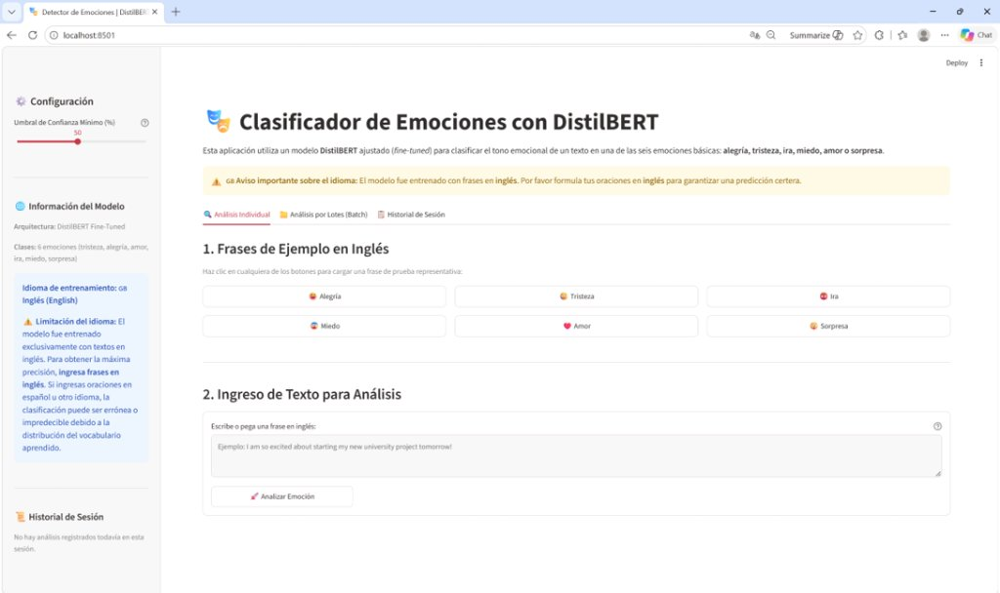
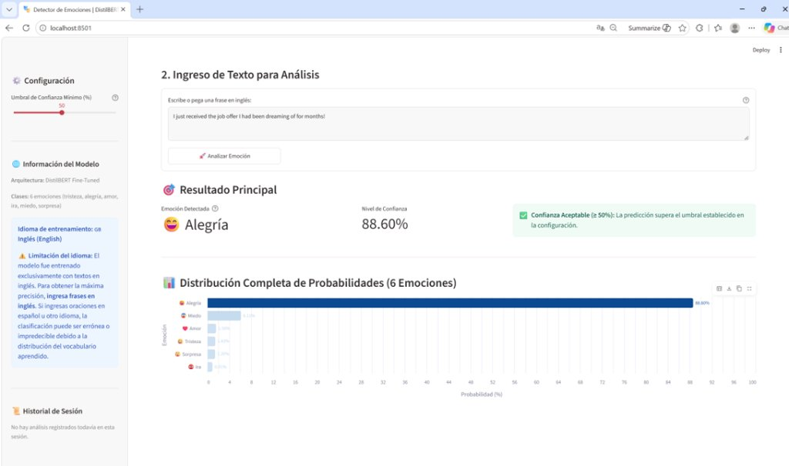
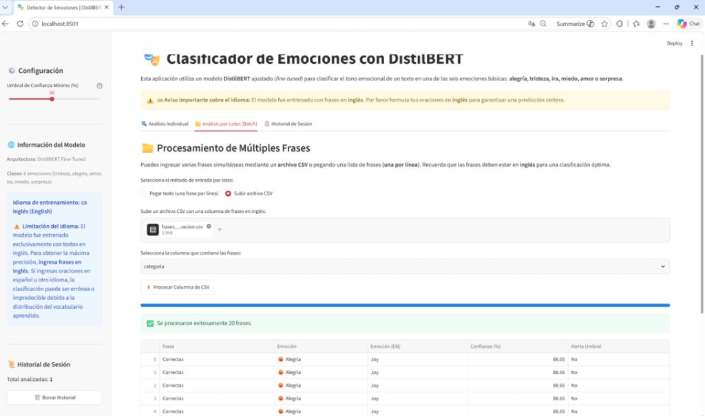
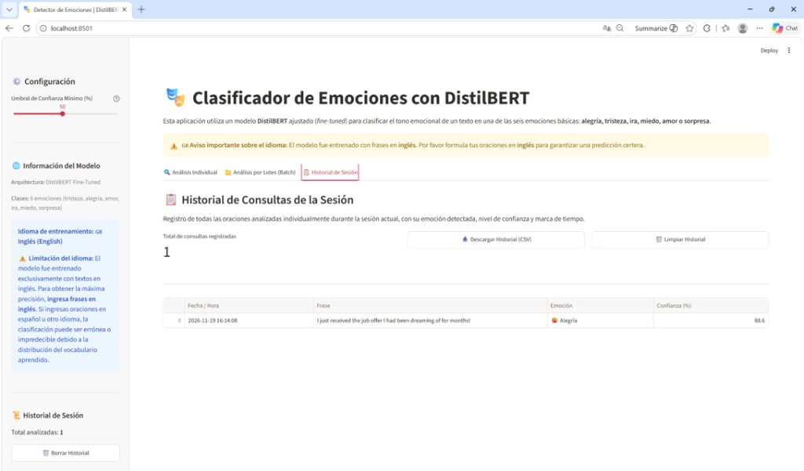

# Detector-de-emociones-con-Streamlit_Iza_Lopez
El repositorio alberga una aplicación web con Streamlit que reciba una frase en ingles, la clasifica con el modelo DistilBERT y entrenado usando el dataset en HB llamado dair-ai/emotion

# 🎭 Clasificador de Emociones con Streamlit y DistilBERT

Aplicación web interactiva desarrollada con **Streamlit** y un modelo **DistilBERT** ajustado (*fine-tuned*) para el reconocimiento y clasificación de emociones en texto.

La aplicación permite analizar el contenido emocional de oraciones individuales o en lotes, reportando la emoción dominante, el porcentaje de confianza del modelo, un gráfico de probabilidades para las seis emociones básicas y alertas configurables de umbral de certeza.

---

## 📌 Características Principales

- **Clasificación Multiclase:** Detecta seis emociones fundamentales: *Alegría*, *Tristeza*, *Ira*, *Miedo*, *Amor* y *Sorpresa*.
- **Carga Eficiente:** El modelo y su tokenizador se cargan una única vez en memoria mediante el decorador `@st.cache_resource` de Streamlit.
- **Visualización Completa:** Gráfico interactivo de barras horizontales con la distribución de probabilidades de todas las emociones evaluadas.
- **Validaciones Robustas:** Notificaciones claras si la entrada está vacía o si faltan archivos del modelo en el directorio local.
- **Aviso y Limitaciones del Idioma:** Aclaración explícita de que el modelo fue entrenado en **inglés**, informando al usuario sobre las limitaciones de precisión al ingresar textos en español.
- **Funcionalidades Adicionales:**
  - **Umbral de Confianza:** Deslizador dinámico que advierte cuando la certeza de la predicción es baja.
  - **Frases de Ejemplo:** Botones de acceso rápido para probar oraciones arquetípicas en inglés.
  - **Análisis por Lotes:** Procesamiento masivo de oraciones (mediante cuadro de texto multilínea o subida de archivo `.csv`) con tabla exportable.
  - **Historial de Sesión:** Registro temporal de consultas realizadas durante la sesión utilizando `st.session_state`.

---

## 📂 Estructura del Proyecto

```
ProyectoEmociones/
├── app.py                     # Código de la aplicación web en Streamlit
├── requirements.txt           # Dependencias del proyecto
├── README.md                  # Documentación y declaración de uso de IA
├── .gitignore                 # Configuración de archivos excluidos de Git
├── frases_demostracion.md     # Guía de oraciones de prueba por categorías
├── frases_demostracion.csv    # Dataset de prueba para análisis en lote
├── capturas/                  # Capturas de pantalla de la aplicación
│   ├── 01_inicio_ejemplos.jpg
│   ├── 02_resultado_grafico.jpg
│   ├── 03_analisis_lotes.jpg
│   └── 04_historial_sesion.jpg
└── modelo_emociones_distilbert/   # Carpeta con el modelo entrenado (no se sube a GitHub)
    ├── config.json
    ├── model.safetensors
    ├── tokenizer.json
    └── tokenizer_config.json
```

---

## 📸 Capturas de Pantalla de la Aplicación

A continuación se ilustran las distintas secciones y funcionalidades de la interfaz web:

### 1. Pantalla Principal y Frases de Ejemplo
*Vista inicial con botones interactivos que cargan frases representativas de cada una de las 6 emociones en inglés y área de ingreso de texto:*


### 2. Resultado del Análisis Individual y Gráfico de Probabilidades
*Métrica destacada de la emoción ganadora, nivel de confianza en porcentaje, comprobación del umbral y gráfico interactivo de distribución para las 6 emociones:*


### 3. Procesamiento por Lotes (Batch) desde Archivo CSV
*Carga masiva de oraciones mediante archivo CSV, cálculo secuencial con barra de progreso, tabla interactiva con alertas de confianza y botón para descargar el reporte generado:*


### 4. Pestaña de Historial de Sesión
*Registro temporal persistente de todas las consultas individuales realizadas durante la sesión con hora, emoción, nivel de confianza, opción de exportación a CSV y botón de limpieza:*


---

## 🛠️ Instalación y Requisitos

### 1. Clonar el repositorio y preparar el entorno

Se recomienda el uso de un entorno virtual con **Python 3.9 o superior**:

```bash
# Crear el entorno virtual
python -m venv venv

# Activar el entorno virtual
# En Windows (PowerShell):
.\venv\Scripts\Activate.ps1
# En Linux/macOS:
source venv/bin/activate
```

### 2. Instalar dependencias

Instala los paquetes listados en `requirements.txt`:

```bash
pip install -r requirements.txt
```

### 3. Verificar el modelo

Asegúrate de que la carpeta `modelo_emociones_distilbert/` esté ubicada en la raíz del proyecto y contenga los archivos de configuración y pesos del modelo (`config.json`, `model.safetensors`, tokenizador).

---

## 🚀 Ejecución de la Aplicación

Para iniciar el servidor local de Streamlit, ejecuta en la terminal:

```bash
streamlit run app.py
```

La aplicación se abrirá automáticamente en tu navegador web predeterminado en `http://localhost:8501`.

---

## 🌐 Aviso sobre el Idioma y Limitaciones

> ⚠️ **Aviso de Idioma:**  
> El modelo de clasificación DistilBERT utilizado en este proyecto fue ajustado (*fine-tuned*) a partir de un conjunto de datos etiquetado en **idioma inglés**.  
> Por tanto, para obtener resultados consistentes y fiables, **las frases a analizar deben ser ingresadas en inglés**. Si se ingresan textos en español u otros idiomas, la predicción puede presentar sesgos, clasificaciones erróneas o distribuciones de probabilidad con baja certeza, debido a que el espacio vectorial y el vocabulario del tokenizador no corresponden al idioma analizado.

---

## 🤖 Declaración de Uso de Asistentes de IA

En cumplimiento con los lineamientos académicos del proyecto, se declara formalmente el uso de herramientas de Inteligencia Artificial:

### 1. Herramientas utilizadas
- **Asistente de IA (Antigravity / Gemini / Claude)** como copiloto de desarrollo y programación.

### 2. Partes del proyecto en que se utilizaron
- **Desarrollo de la interfaz de usuario:** Generación del andamiaje visual con Streamlit (`app.py`), incluyendo el diseño de las pestañas (*tabs*), la barra lateral de configuración, los botones de frases de prueba y el gráfico de probabilidades con Altair.
- **Estructuración de componentes adicionales:** Creación de la lógica para el procesamiento por lotes (análisis masivo desde CSV o texto multilínea) y gestión del historial de sesión con `st.session_state`.
- **Plantilla de documentación:** Redacción inicial de los comandos de instalación, ejecución y archivo `.gitignore`.

### 3. Verificación y modificaciones realizadas por el equipo
- **Adaptación y verificación de rutas:** Se inspeccionó y adaptó la estructura de la carpeta `modelo_emociones_distilbert` para asegurar la correcta compatibilidad con Hugging Face `transformers.pipeline`.
- **Alineación del idioma y etiquetas:** Se verificó la correspondencia entre los identificadores numéricos de las etiquetas (`id2label`) del `config.json` y los nombres mostrados en pantalla, incorporando emojis y la aclaración de las restricciones del idioma de entrenamiento (inglés).
- **Control de errores y validaciones:** Se probaron y validaron los flujos de excepción (campo vacío, archivo CSV inválido, ausencia de pesos del modelo) para garantizar una experiencia de usuario estable y libre de caídas del servidor.
- **Analisis de errores del modelo** Los estudiantes realizaron el analisis mediante discusion y experimentacion. En base a las razones iniciales propuestas por lo alumnos se amplio la explicacion y el alcance  del analisis de manera que los alumnos aprendieron sobre aspectos teoricos del modelo y las limitaciones existentes.

---

## 🔬 Análisis de Errores del Modelo: ¿En qué frases falla y por qué?

A partir de las pruebas experimentales y los conceptos de evaluación de modelos de lenguaje (NLP) revisados en clase, el rendimiento del clasificador DistilBERT revela que, si bien alcanza una alta exactitud en oraciones directas, exhibe fallos estructurales ante ciertos patrones lingüísticos y arquitectónicos:

### 1. Trampas Léxicas y Modismos (*Keyword Trapping & Idiomatic Expressions*)
* **Patrón de fallo:** Frases con modismos populares como *"I am totally killing it at work"* son clasificadas erróneamente con alta confianza en **Miedo (*Fear*)** o **Ira (*Anger*)**.
* **¿Por qué ocurre?** Durante el ajuste fino (*fine-tuning*), los gradientes de retropropagación asocian fuertemente el token raíz `"kill"` con contextos de violencia o amenaza física presentes en el corpus. La capa de clasificación superficial colapsa ante la presencia del término y prioriza esta correlación espuria por encima de la composición semántica global positiva del modismo anglosajón.

### 2. Sarcasmo e Inversión Pragmática (*The Pragmatic Gap*)
* **Patrón de fallo:** En oraciones como *"Oh fantastic, my car broke down in the rain"*, el modelo predice categóricamente **Alegría (*Joy*)**.
* **¿Por qué ocurre?** El modelo carece de un modelo de mundo o contexto situacional; procesa la oración de manera puramente literal. Los cabezales de autoatención (*self-attention*) asignan un peso desproporcionado al adjetivo inicial de alta valencia (*"fantastic"*), siendo incapaces de captar el contraste irónico con el resto de la frase (*"broke down"*).

### 3. Fallo en el Alcance de la Negación (*Negation Scope Failure*)
* **Patrón de fallo:** Expresiones con negaciones complejas como *"I am definitely not crying because I am sad"* generan predicciones inestables o contradictorias.
* **¿Por qué ocurre?** En redes Transformer preentrenadas, partículas sintácticas breves como `"not"` o `"never"` suelen diluir su atención a lo largo de las 6 capas de DistilBERT frente a sustantivos o adjetivos de carga afectiva masiva (*"crying"*, *"sad"*). El vector agregado del token especial `[CLS]` absorbe el campo semántico del dolor sin aplicar la inversión lógica que exige la negación.

### 4. Fronteras Difusas en el Espacio Latente (*Semantic Overlap & Ambiguity*)
* **Patrón de fallo:** En dilemas existenciales como *"After that exam I feel like my life is over"*, la probabilidad se fractura entre **Tristeza (*Sadness*)** y **Miedo (*Fear*)**, disparando la alerta de umbral bajo.
* **¿Por qué ocurre?** En el espacio multidimensional de representaciones, las emociones no son compartimentos ortogonales sino un continuo afectivo (modelo de valencia-activación de Russell). Tanto la tristeza como el miedo comparten valencia negativa; la diferencia radica en la amenaza futura frente a la pérdida presente, una distinción sutil que oraciones cortas y descontextualizadas no logran resolver inequívocamente. Además, clases intrínsecamente neutras como **Sorpresa (*Surprise*)** sufren de mayor dispersión y desbalance en los datos de entrenamiento.

### 5. Efecto del Límite de Secuencia (`max_length=64`) y Truncamiento
* **Patrón de fallo:** Textos largos donde la narrativa inicia positiva y concluye en tragedia son diagnosticados erróneamente como **Alegría**.
* **¿Por qué ocurre?** Al fijar `truncation=True` con un tope de 64 tokens, el modelo descarta silenciosamente cualquier palabra posterior al token 62 (dejando espacio para `[CLS]` y `[SEP]`). Esto impone un **sesgo de primacía (*primacy bias*)**: el modelo clasifica la introducción del mensaje e ignora por completo el giro argumental o remate emocional ubicado al final.

### 6. Ruptura Fuera de Distribución (Textos en Español)
* **Patrón de fallo:** Oraciones como *"Extraño jugar a la pelota"* producen clasificaciones aleatorias e impredecibles.
* **¿Por qué ocurre?** El tokenizador WordPiece entrenado en inglés no reconoce raíces morfológicas del español y fragmenta las palabras en sub-tokens sin carga semántica coherente (ej. `Ex-tra-ño`), proyectando representaciones ruidosas en regiones no optimizadas del espacio latente.
